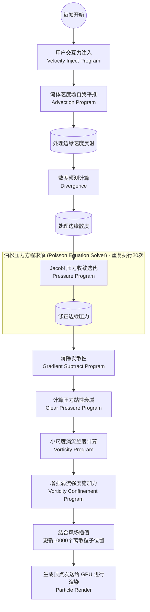

# WebGPU 3D 流体模拟底层技术剖析：架构探索与实现细节

这份报告将使用图解与代码片段，深度切入项目的**架构实现**、**数学原理与仿真算法**、以及**3D 粒子渲染管线**三个维度。

## 一、 系统架构图与模块协同

本项目采用轻巧的无构建工具 (Vanilla JS) 结构，核心目标是在 CPU 端（JavaScript）和显卡渲染端（WebGPU Device）之间架设调度桥梁。

### 1.1 全局架构概览
```mermaid
graph TD
    subgraph Browser Side (CPU)
        Main[main.js<br>执行核心主循环及调度]
        Init[init.js<br>初始化环境设备、GUI状态]
        Utils[utils.js<br>面向对象的WebGPU资源抽象]
        Shaders[shaders.js<br>存储底层物理数学计算规则]
        Renderer[particleRender.js<br>3D坐标与混合渲染设置]
    end

    subgraph GPU Device (WebGPU)
        Compute[Compute Pipelines <br>10x Shader 核心物理运算段]
        Storage[Storage Buffers <br>DynamicBuffer显存共享数据]
        Graphics[Render Pipeline <br>Instance Rendering]
    end

    Main -->|请求设备上下文| Init
    Main -->|通过Uniform/Program调度| Utils
    Main -->|触发Render| Renderer
    Utils -->|读取| Shaders
    Utils -.->|创建调度缓冲| Compute
    Utils -.->|读写| Storage
    Renderer -.->|绘制调用| Graphics
```

- **`utils.js` 精妙封装**：原生的 WebGPU 存在极高心智负担，而 `DynamicBuffer`、`Uniform`、`Program` 三个类的封装起到了至关重要的作用。比如 `DynamicBuffer` 提供一套极简的 `copyTo` 直接对应 `copyBufferToBuffer`，而 `Program` 隐藏了 BindGroupLayout 与 ShaderModule 的细节，暴露一个即插即用的 `dispatch` 函数。

### 1.2 主渲染循环的生命周期
主循环每帧（`requestAnimationFrame` 中调用 `step` 方法）的核心物理流程，这是依据 Jos Stam "Stable Fluids" 算法的标准流程。



---

## 二、 核心仿真算法原理及代码细节解析

这个基于欧拉网格 (Eulerian Grid) 的仿真算法试图数值求解**纳维-斯托克斯 (Navier-Stokes) 方程组**。假设使用的模拟空间大小为 128x128x128 3D 体素。

### 2.1 速度注入 (Splat Injection)
根据用户的点击行为，给予流体力学场一个外部推动。项目中采用了 3D 的拉普拉斯球型高斯分布（Gaussian Splat）平滑力值：
> 💡 *代码节选 (`velocityInjectShader`):*
```wgsl
let splat = exp(-dot(p.xz, p.xz) / radius - dot(p.yz, p.yz) / radius * 0.1) * v;
```
这一步不仅加入新速度，并且伴随 `uDiffusion` 每帧都会造成速度场的微小扩散或消失。

### 2.2 对流平流 (Advection) - *“顺水推舟”*
流场拥有自己的速度向量，流场内的物质也会被流场自身推着走。由于在不连续网格上推断粒子去向会导致极度失真问题，算法采取了经典的 **半拉格朗日法 (Semi-Lagrangian Method)**：
如果要知道网格 $P$ 点下一帧的速度，我们就反向沿着当前 $P$ 点的速度向量回溯 $dt$ 的时间（也就是看看到底是谁流入到了当前坐标 $P$），然后取原位置环境周围 8 个像素顶点，作**三线性精准插值 (Trilinear Interpolation, `trilerp` 模块)** 得到目标数据：
```wgsl
var bx = pos.x - uDt * uGrid.rdx * vel.x; // rdx 代表时间步长倍率反向回溯
// ... 取得临近 8 点速度的系数 `tx`, `ty`, `tz` 进行加权平滑三维混合 ...
let c00 = mix(c000, c100, tx); 
// ... 混合完成
```

### 2.3 散度清零：压力的雅可比松弛解法 (Jacobi Iteration)
在自然界流体假设中认为水具有“绝对不可压缩性”。速度场因为“注入”和“平推”而产生畸变之后，总有些地方有“流体要爆出”的趋势（发散/汇集），这就需要通过产生强大的**压力梯度力**抵制这种压缩。项目中分为三步：

1. **计算现有速度的散度偏导 (`Divergence`):**
   ```wgsl
   div[index] = 0.5 * uGrid.rdx * ((R.x - L.x) + (T.y - B.y) + (Bk.z - F.z)); 
   ```
2. **泊松方程求压力场 (`Pressure Solver`):**
   由于压力场的影响是全局辐射的（即池塘一边掉个石头另一边都会瞬间漫出），使用雅可比法利用近邻 6 个方位的已知压力反复拉扯求稳（本项目循环指定 20 次）。
   ```wgsl
   let alpha = -(uGrid.dx * uGrid.dx);
   let rBeta = 1.0 / 6.0;   // 1 除以周围受力的 6 块邻接网格
   pres_out[index] = (Lx + Rx + Bx + Tx + Fx + Bkx + alpha * div[index]) * rBeta;
   ```
3. **梯度扣除 (`Gradient Subtract`):**
   有了压力场后，求其斜率反向压向当前速度矢量，从而保证了新速度场**零散度 (Divergence-Free)**。新速度被彻底修正为不违背现实物理。

### 2.4 涡度限定法挽救细节 (Vorticity Confinement)
插值和网格摩擦会不可避免地令流体产生巨大的“数值粘性”(Numerical Dissipation)——流体一不小心就变得像粘稠的蜂蜜，没法打出美丽的旋涡。为了重新夺回这些流失的漩涡：
1. `vorticityShader` 用**旋度操作 (Curl)** 公式算出空间内所有轴心的角速度。
2. `vorticityConfinementShader` 进行增强放大，然后向着流体速度场加力（外积形式）：
```wgsl
// 将单位化的涡度变化趋势（eta）与当前局部旋转（curl）交叉相乘，生成推力补偿
let force = uGrid.dx * uVorticity * uDt * cross(eta, curl); 
```

---

## 三、 3D粒子系统渲染管线极简美学

不可见的 3D 速度数据需要变成可欣赏的花火。此项目采用了**拉格朗日粒子模拟法**把 10,000 个发光粒子置身于风场内进行位置迭代。

### 3.1 粒子更新 (`particleUpdateShader.wgsl`)
和流场平流如出一辙，在独立的 GPU Pass 里读取包含 3 万个 Float 数位的 `positions` 存储区以及 1 万个数据的 `life` 数组：
- 把粒子当前浮点位置放进速度网格场中，通过**三维插值算法寻址**出粒子所在受到的绝对流体力。
- 利用流体力进行前向欧拉步更新坐标。寿命扣减去 `uDt`。

### 3.2 自定义固定流水线 (`particleRender.js`)
没有导入 Three.js 或 Babylon.js，仅仅为了性能而生刻。设计了一个 **Instancing Rendering (基于实例绘图)** 方案。

1. **共享 Vertex 资源及透视几何 MVP**：仅仅发送了包含 6 个顶点组成的正方形 Quad 到 GPU，代表一张面向屏幕的 “贴纸” (Billboard)。在 CPU 结合观察者固定机位（利用 `lookAt([0,0,2.2], [0,0,0])`）手动生成 `Projection * View` MVP 列主序矩阵传给 Uniform Shader：
```javascript
// 透视参数设定
const fov = 45 * Math.PI / 180;
const near = 0.1, far = 10.0;
```

2. **Vertex Shader 重定位 (Vertex Repositioning)**：
每处理一次矩形实例，根据 `instanceIndex` 从流缓冲区抓取对应一个独立粒子的 $(X,Y,Z)$ 进行乘加换算，把这个平面推向空间指定位置（如果 `life` 已用尽，则暴力的赋予 `(2.0, 2.0)` 将其抛出可见剪裁区提升性能）。并将粒子远近的 Z 轴缩放附加到了平面放大倍率上 `screenSize`。

3. **片段着色器计算球性粒子轮廓与上色**：
我们根本没有提供真正的圆形网格，更没有采用圆形的图片纹理。依靠 UV 距离计算，将一个正方形剪切成了边缘朦胧的柔软发光圆面：
```wgsl
let dist = length(fragData.uv); // UV坐标映射在 [-1, 1]，测算离圆心长度
if (dist > 1.0) { discard; }    // 粗暴修剪：圆饼之外的边角，即刻抛弃，不绘制色彩
// 产生柔光晕羽化过渡，越靠边缘 Alpha 渐弱
let alpha = 1.0 - smoothstep(0.7, 1.0, dist); 
```

4. **色彩寿命挂钩及融合混合律**：
颜色不再是固定写死的！Shader 根据 `lifeRatio = 剩下的存活时间 / 最大寿命` 来插值。寿命足是艳黄跳跃到浅绿，即死前变为暗淡冷红。
最关键的一步是位于 JS 的 `device.createRenderPipeline` 中的颜色算式：使用 `src-alpha` 和 `dst-on` 做**加法混合**，由于没有进行 Z 深度遮挡检测排斥 (`depthWriteEnabled: false`)，千万个半透明的红绿粒子叠加，亮度累积便形成了我们所看见的类似宇宙星云风暴般炫目的明亮 3D 光感流体结构。
