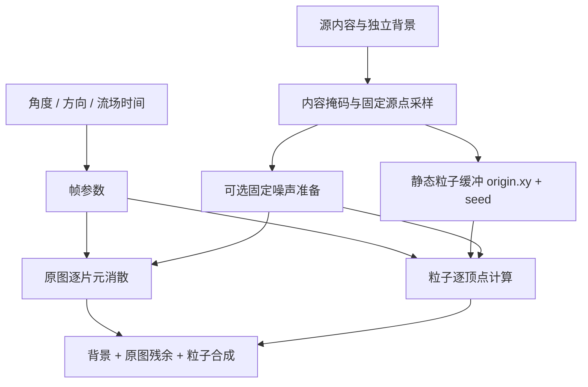

# 粒子动效：效果修复、算法优化与移植指南

编写日期：2026-10-30。代码依据：`da50e9a`；修改前基线：`ef78baa`；分支：`feature/dissolve-grain-fix`。

本指南面向渲染、系统 UI 和原生平台开发人员，区分已经实现的改动与后续建议。文中的“原生建议”不是仓库已完成的原生实现。

## 1. 接入结论与版本选择

**建议先移植默认的编织纹修复版本，再在目标设备逐项测试性能候选。**目前没有稳定证据支持将预计算或七项组合直接作为更快的上线默认。

| 类别 | 已实现的修改 | 当前状态 | 接入建议 |
| --- | --- | --- | --- |
| 视觉修复 | 更换释放阈值的细粒度 grainHash | 默认启用；原图、粒子和烘焙同步 | 优先接入 |
| 固定噪声预计算 | 粒子静态属性缓存；可选原图扰动纹理 | 默认关闭；增加准备成本和存储 | 独立测量后决定 |
| 单项算法近似 | uniforms/noise2/hashfast/envelope/radial/wave/growth | 可选实验；部分改变视觉 | 一次接入一项 |
| 组合算法 | combined 同时启用七项 | 可选实验；无稳定加速结论 | 单项验收后再组合 |
| 开发设施 | 同步对照、分层、差异图、GPU 查询、消融诊断 | 验证工具 | 不作为产品运行依赖 |

当前 demo 通过 `getContext('webgl')` 创建上下文，是 **WebGL1 参考实现**；仓库名称不代表这条路径已经使用 WebGPU/WGSL。当前没有完整手机 SDK、原生快照服务或系统生命周期实现。

### 1.1 模式含义

| 配置 | 实际行为 |
| --- | --- |
| 默认参数 | 已修复释放细纹；原有轨迹；不预计算 |
| shaderVariant: 'original' | 当前已修复的基础算法，不是历史缺陷版本 |
| legacyRelease: true | 仅恢复旧释放细粒度 hash，供前后对照 |
| precomputeNoise: 'particles' | 缓存粒子的两个固定噪声值 |
| precomputeNoise: 'all' 或 true | 粒子缓存＋原图释放扰动纹理 |
| shaderVariant: 'uniforms' 等 | 一个算法候选，不叠加预计算 |
| shaderVariant: 'combined' | 七项候选组合到同一套 shader，不是七个额外 pass |

代码禁止“预计算＋近似”，也禁止“legacyRelease＋预计算/近似”。这是为了隔离实验并避免释放规则失配；原生端若扩展这些组合，需重新实现缓存生成和一致性验证。

## 2. 基础数据流与不变约束



- CPU 准备源点和固定种子，不逐帧积分所有粒子的位置。
- GPU 每帧从源位置、种子、进度和流场时间直接求状态，支持角度跳转与反向。
- 每屏内部通常绘制原图 quad 和粒子 points；背景及最终拷贝由当前 Canvas 2D 路径完成。
- 桌面使用独立壁纸＋透明内容；应用使用底色/背景细节＋内容掩码。
- 内容块只确定掩码和采样归属，不是整体飞行的运动单元。

### 2.1 两个时间不要混用

```text
normalizedAngle = clamp(angleDegrees / 180, 0, 1)
outerDissolve = normalizedAngle
innerDissolve = 1 - normalizedAngle
time = 1.65 * pow(dissolve, 0.78)
```

`time` 是角度推导的动效状态，不是必须播放 1.65 秒。`fieldTime` 是秒单位的流场相位，角度固定时仍可演化。反向开合不要重置源点、种子和会话相位；固定全部输入时应可复现。

默认 direction=-1：右侧先碎化，粒子向左运动。凝聚通过进度回退自然产生。外屏方向开关只改变外屏方向，不需要创建另一套粒子计时器。

## 3. 效果修复：消散编织纹

### 3.1 修改原因

消融实验确认：不画任何粒子，仅绘制原图消散层，蓝色大卡片仍有规则斜纹；改变粒子采样或关闭流场未消除；保留扰动频率与幅度、只更换细粒度 hash 后斜纹明显减弱。因此修复定位在释放阈值的细粒度随机项。

尚未独立证明浮点精度、点积映射相关性和缩放混叠各自的贡献比例，不应归结为单一 GPU 精度故障。

### 3.2 最小公式修改

原通用 hash 保留，继续服务低频值噪声及速度、尺寸、寿命等属性：

```glsl
float hash(vec2 p) {
    return fract(sin(dot(p, vec2(127.1, 311.7))) * 43758.5453);
}
```

新增释放专用函数，只将 birth 中的 `hash(floor(p*.65))` 换为 grainHash：

```glsl
float grainHash(vec2 p) {
    vec3 v = fract(vec3(p.xyx) * .1031);
    v += dot(v, v.yzx + 33.33);
    return fract((v.x + v.y) * v.z);
}

float birth(vec2 p) {
    float u = p.x / resolution.x;
    return .045
        + mix(1. - u, u, step(0., direction)) * .50
        + noise(p * .009) * .18
        + grainHash(floor(p * .65)) * .20;
}
```

约 1.54 逻辑像素的细粒度格点、.20 幅度、.18 低频幅度和 .26 淡出宽度均保留。改变的是局部随机映射；方向与渐进释放结构保持。

### 3.3 必须同步的文件

| 路径 | 文件 | 要求 |
| --- | --- | --- |
| 共用定义 | [common.glsl](../src/shaders/common.glsl) | 一致的 hash/noise/birth |
| 原图消散 | [baseFragment.glsl](../src/shaders/baseFragment.glsl) | 每片元按源坐标求新 birth |
| 桌面粒子 | [desktopVertex.glsl](../src/shaders/desktopVertex.glsl) | age 使用新 birth |
| 应用粒子 | [appVertex.glsl](../src/shaders/appVertex.glsl) | age 使用新 birth |
| 原图缓存烘焙 | [noiseBakeFragment.glsl](../src/shaders/noiseBakeFragment.glsl) | 新 grainHash 参与 disturbance |
| 粒子缓存烘焙 | [particleNoiseBakeVertex.glsl](../src/shaders/particleNoiseBakeVertex.glsl) | 按真实源点使用同一公式 |

不能全局替换所有 hash，不能只改原图或只改粒子，也不能按卡片局部坐标重新开始计算。以下关系保持：

```glsl
float b = birth(origin);
float age = max(0., time - b);
float remain = 1. - smoothstep(b, b + .26, time);
float particleIn = smoothstep(0., .14, age);
```

原图渐退与粒子渐入有重叠。使用移动后的位置求 birth，或每帧更换随机种子，会造成闪烁、释放脱节及反转失配。该修复保留正常细颗粒，不代表全局噪声算法或 GPU 性能已优化。

## 4. 算法候选 A：固定噪声预计算

### 4.1 缓存的数据与运行时公式

```glsl
float disturbance = noise(origin * .009) * .18
                  + grainHash(floor(origin * .65)) * .20;
float localNoise = noise(origin * .016);

// 每帧仅合成方向梯度，并使用缓存的两个值。
float b = .045 + horizontalGradient * .50 + disturbance;
float age = max(0., time - b);
float release = smoothstep(.035, .32, age);
float localAge = max(0., age + (localNoise - .5) * .10 * release);
```

速度、扩散、寿命和直径的六次固定 hash 仍未缓存；四次动态域扭曲 noise 仍逐帧计算。不要将本实现描述为所有静态属性均已预计算。

每颗粒子每帧移出的 hash 类求值：桌面 5 次，应用 9 次。修复后这些计数包含 grainHash，不等于都是 sin，更不等于原生 GPU 指令或时间比例。

### 4.2 当前准备过程与内存

```text
原 GPU 公式在真实 origin 上求值
→ 临时 RGBA8 点图集
→ 准备阶段一次 readPixels
→ CPU 解码为两个 Float32
→ 静态顶点属性 VBO
→ 删除临时图集、UV 缓冲、FBO 和烘焙程序
```

每帧读取 `attribute vec2 fixedParticleNoise`，不新增顶点纹理采样，也不逐帧回读。持久 GPU 数据为每颗粒子 8 字节；默认应用双屏约 56 万粒子，约增加 4.28 MiB。准备时的临时资源与 JS 数组不包含在此数值内。

原生建议：目标后端若支持合适的 GPU 缓冲生成机制，可直接生成固定属性，避免复制 WebGL1 的同步回读。仓库未实现此原生路径；CPU 与 GPU 分别求浮点 hash 也不能默认逐位相同。

### 4.3 RGBA8 编码不可按图片处理

disturbance/.38 编码到 RG，localNoise 编码到 BA，每个值用两通道 UNORM16：

```text
n  = floor(clamp(value,0,1) * 65535 + 0.5)
hi = floor(n / 256)
lo = n - hi * 256
storedPair = (hi,lo) / 255
value = (R*65280 + G*255) / 65535
```

- 使用普通 UNORM 数据格式，禁用混合和抖动；不做 sRGB 转换或图片压缩。
- BA 中的 A 是数据字节，不是透明度；不能经过预乘 alpha 的图片处理流程。
- 编码纹理使用 NEAREST，跨通道线性过滤不能等价插值解码值。
- disturbance 解码后乘回 .38。理想量化误差上界约 .38/(2*65535)，另有浮点误差。

### 4.4 原图扰动纹理与失效规则

`precomputeNoise:'all'` 另建与实际离屏目标同尺寸的 RGBA8 纹理。运行时以 `gl_FragCoord.xy/noiseSize` 读取 disturbance，再合成方向梯度。没有用低分辨率纹理近似细粒度扰动。

当前双屏 2 倍宽高的额外原图纹理约 26.93 MiB。新增纹理访问和解码可能比原公式更慢，本机历史样本确实回退，因此默认关闭。

| 输入变化 | 粒子固定属性 | 原图扰动纹理 |
| --- | --- | --- |
| angle / fieldTime / direction | 不重建 | 不重建 |
| 源点坐标、数量或顺序 | 重建或同步重排 | 通常不受影响 |
| 采样间距、内容掩码 | 重新采样并重建 | 坐标尺寸相同时数学上可复用 |
| 逻辑屏幕尺寸 | 重建 | 重建 |
| 仅离屏输出尺寸 | origin 不变时数学上可复用 | 重建 |
| 噪声函数/频率/幅度版本 | 重建 | 重建 |
| 仅源 RGB | 噪声数学上可复用，颜色纹理必须更新 | 噪声数学上可复用 |

这是依赖关系，不代表当前 API 支持局部更新。demo 在创建 renderer 时准备，快照或档位改变通过销毁/重建处理，没有跨 renderer 共享缓存。

`prepareMs` 是含回读等待与解码的墙钟时间，不是纯 GPU 烘焙时间。缓存失败回退实时算法，原因通过 noiseCacheStatus 记录。原生端应保留明确回退和资源释放机制。

## 5. 算法候选 B：七项单项实验

变体由 [shader-experiments.cjs](../tools/shader-experiments.cjs) 生成。以下减少的是源码层面工作，不是已确认加速。

| 模式 | 实际改动 | 范围 | 主要风险 |
| --- | --- | --- | --- |
| uniforms | 8 个公共三角函数项每帧算一次，经 uniform 传入 | 桌面/应用 | CPU/上传成本、浮点差异 |
| noise2 | 去掉嵌套 warp，动态 noise 从 4 次改为 2 次 | 仅应用 | 流场更规则 |
| hashfast | 动态 bend 的 noise 使用无 sin hash | 仅应用 | 随机形态和相关性改变 |
| envelope | 双涡区 exp 包络改多项式 | 桌面/应用 | 涡区范围与密度改变 |
| radial | 圆点柔边改用距离平方 | 桌面/应用 | 覆盖、浓度改变 |
| wave | 4 个空间 sin 换平滑三角波 | 桌面/应用 | 波形误差放大为位移 |
| growth | 饱和增长 exp 改有理式 | 桌面/应用 | 扩散/扰动介入节奏改变 |

### 5.1 uniforms：常量对应关系

使用 `phase=fieldTime*1.2`，不是 time*1.2：

```text
flowRadius = min(W,H) * (0.30 + 0.035*sin(phase*0.81))
flowAmplitudes = (
    119 + 32*sin(phase*0.91),
     94 + 26*cos(phase*0.77),
     90 + 25*sin(phase*0.69))
flowOffsets = (
    0.42*sin(phase),
    0.36*cos(phase*0.89),
    0.48*sin(phase*0.83),
    0.38*cos(phase*0.71))
```

GPU 替换 transport 中的相同项。usesFlowUniforms 同时标记单项和组合，漏上传会使半径/振幅异常，甚至丢粒子。

原生常量缓冲可按目标 ABI 将 radius＋三个 amplitudes 放入一个 vec4，四个 offsets 放入另一个 vec4。这是布局建议；当前 JS 实际为 float、vec3、vec4 三个独立 uniform。GPU 计时不含 CPU 三角函数成本，需另测整帧 CPU。

### 5.2 noise2：减少层级，不保持同一条轨迹

原版先两次 noise 生成二维 warp，再两次 noise 生成 bend。候选保留两个尺度：

```glsl
float phase = fieldTime * .93;
vec2 q = vec2((direction*origin.x-time*210.)*.0035, origin.y*.004);
float bend = (noise(q + vec2(phase*.28,-phase*.17))-.5)*180.
           + (noise(q*2.2 + vec2(-phase*.25,phase*.31))-.5)*58.;
```

动态 noise 从 4 次降至 2 次，内部 hash 从 16 次降至 8 次，去掉中间 warp 的依赖。这是结构简化，不是数值等价近似。当前 noise 是四角随机标量插值的二维值噪声，不是柏林梯度噪声，也不是标准四层 fBm。

### 5.3 hashfast：不要与视觉修复混淆

[fastMotionNoise.glsl](../src/shaders/fastMotionNoise.glsl) 提供 motionHash 和 motionNoise。motionHash 与 grainHash 当前混合公式相同，作用却不同：

- grainHash 是默认修复，只作用于 birth 的细粒度项。
- motionHash 是可选实验，只作用于动态 bend 的四次 noise。
- 原 hash 继续用于基础 noise 和静态粒子属性。

motionNoise 保留四角值插值与三次平滑，只更换随机值来源。不能全局换 hash 后仍声称只修改了动态扰动。

### 5.4 envelope：指数包络换四次方

```glsl
// 原版：exp(-z)
float compactEnvelope(float z) {
    float t=max(0.,1.-z*.25);
    float t2=t*t;
    return t2*t2;
}
```

代入两个涡区的 z：q.y²*.72+q.x²*.24，以及 q.y²*.85+q.x²*.27。中心值和单调衰减保留，远处提前归零。此前 CPU 采样在 z∈[0,8] 的最大绝对差约 .074；这是标量误差，乘振幅后可能产生数像素位移差。

### 5.5 radial：覆盖核改变

```glsl
// 原版：1-smoothstep(.13,.5,length(gl_PointCoord-.5))
vec2 d=gl_PointCoord-.5;
float s=max(0.,1.-4.*dot(d,d));
float radialAlpha=s*s;
```

避免 length，但不是等价圆点。仍需 `a=color.a*radialAlpha`、输出 `vec4(color.rgb*a,a)`。历史指定帧的过渡层 alpha 总量减少约 5.6%，必须评审覆盖感，不能把更稀、更暗当作纯性能优化。

### 5.6 wave：仅近似空间波形

```glsl
float fastWave(float x) {
    float tri=1.-4.*abs(fract(x*.159154943091895+.25)-.5);
    return tri*(1.5-.5*tri*tri);
}
```

替换两个 roll 和两个 ribbon 的外层空间 sin；不替换全局相位 sin/cos、hash 内的 sin 或固定 origin.y 调制。此前单周期 CPU 采样最大绝对差约 .020，乘振幅后会产生位移差。原生 sin 可能已经便宜，手写式不保证更快。

### 5.7 growth：改变增长曲线

```glsl
float fastGrowth(float x) {
    return 1.-1./(1.+x*(1.+x*(.5+x/6.)));
}
```

替换 transport 的 1-exp(-age*2.7) 和应用 bend 的 1-exp(-localAge*4)，其他 age、alpha、smoothstep 不改。x≥0 时从零单调增长；此前 x∈[0,8] 的 CPU 采样最大绝对差约 .0272。它包含倒数，收益需实测。

## 6. 组合版本与接入顺序

组合是七项变换的并集，不增加七个 pass：

1. 先生成公共 uniform 版本。
2. 应用内先去掉 warp 留下两次 noise，再让这两次使用 motionNoise；不能引用已删除的 warp。
3. 两个涡区改 compactEnvelope，四个空间波形改 fastWave。
4. 两处增长函数改 fastGrowth，片元切换距离平方核。
5. CPU 上传公共 uniform，并保持修复后的原图/粒子 birth。

桌面没有额外动态 bend，实际只生效五项；应用七项均生效。组合不包含预计算。不能把单项加速比例相加，也不能由少了 sin/exp 推断实际更快。

## 7. 文件地图与构建要求

| 文件/入口 | 职责 |
| --- | --- |
| [particle-renderer.js](../src/particle-renderer.js) | 采样、资源、缓存、模式、uniform、绘制 |
| [fold-clock.js](../src/fold-clock.js) | 角度、双屏互补进度、方向；本轮未改 |
| [common.glsl](../src/shaders/common.glsl) | 共用 hash/grainHash/noise/birth |
| [transport.glsl](../src/shaders/transport.glsl) | 原版输运公式参考，不是自动 include |
| appVertex / desktopVertex / baseFragment | 完整可编译 shader，内含共用定义副本 |
| noiseBakeFragment / particleNoiseBakeVertex / noiseCodec / noiseCache | 缓存生成、编码和消费 |
| [shader-experiments.cjs](../tools/shader-experiments.cjs) | 有标记检查的单项/组合源码变换 |
| [build-shaders.cjs](../tools/build-shaders.cjs) | 打包 shader、缓存变体和历史释放版本 |
| [shader-sources.js](../src/shader-sources.js) | 浏览器实际加载的生成文件，勿单独手改 |
| [shader-benchmark.js](../src/shader-benchmark.js) | 同 context 的 GPU A/B |
| [compare.html](../demo/compare.html) / compare.js | 修复、单项、组合和预计算的对照入口 |

**构建器不会自动把 common.glsl 或 transport.glsl 的修改传播到完整顶点/片元文件。**共用函数需同步各副本；烘焙又从 common 拼接，漏改会失配。原生工程建议抽成真正共享的模块/包含文件。

修改源码后：

```text
node tools/build-shaders.cjs
node tools/update-manifest.cjs
node tools/verify-package.cjs
```

GLSL 排版或变量名重构也可能影响字符串变换，应同步构建器并验证所有变体能编译。

## 8. 原生移植易错点

### 8.1 准备阶段与帧阶段

每快照准备内容版本、逻辑尺寸、内容/背景纹理、掩码、origin/seed、可选固定噪声及就绪信号。每帧只更新 angle→dissolve/time、direction、fieldTime 和可选公共流场常量。

[contracts.d.ts](../src/contracts.d.ts) 只是契约草案；截图权限、版本同步、线程、fence 和 Surface 生命周期仍需目标平台实现。

### 8.2 坐标和纹理

- 统一屏幕正视的逻辑坐标，原点左上；origin、原图片元、掩码必须一致。
- birth 与源颜色使用源位置；跨卡片共享全屏坐标，不用移动后位置。
- 当前 quad 翻转 y，扰动缓存按 framebuffer 像素读取。明确目标 API 的原点约定，不能重复翻转。
- 对齐像素/texel 中心，不用邻近片元阈值直接代替任意粒子的精确 source 值。
- 点尺寸中的 *2 对应两倍离屏尺寸；原生换成输出/逻辑统一倍率，不额外再乘 DPR。

### 8.3 缓冲布局和精度

- JS 源缓冲每点三个 Float32、12 字节；可选噪声为独立两个 Float32、8 字节。
- 原生 storage/constant buffer 的 vec3、结构体数组有目标布局要求，不能假定拼成 20 字节就通用。按 ABI/反射结果设置偏移和步长。
- 不同 program/pipeline 的属性和常量位置可能不同，缓存版与原版绑定不能盲用。
- hash/birth/流场先保持足够精度，对齐视觉后再测降精度。浮点 hash 不保证跨 CPU/GPU、跨设备逐位一致。
- 其他语言的 fract 应保持 x-floor(x) 语义；动态噪声有负坐标，不能用符号行为不同的余数函数代替。

### 8.4 透明度与合成

- 背景先画；应用底色永久不透明；桌面壁纸独立。
- 源纹理、输出和混合统一预乘 alpha；当前 blend 为 ONE / ONE_MINUS_SRC_ALPHA。
- 粒子采样后先除 alpha 得到直色，混色后输出时只乘回一次，避免黑边。
- 数值缓存不能套用颜色纹理的颜色空间转换、压缩和预乘流程。
- 目标 API 没有等价点精灵时，可用实例化 quad 实现同样覆盖函数，再测填充开销。
- q=0 直出完整界面，q=1 只有背景；末尾淡出也是合成规则，不能只复制粒子 vertex shader。

### 8.5 生命周期

准备应在动画关键路径前完成。快照/尺寸变化、缓存失效、后台、Surface 丢失和取消时要正确释放/重建资源与同步对象。对照工具的临时源码切换、readPixels、loseContext 不应照搬成原生逐帧产品流程。

## 9. 实测结论与证据边界

截至本文，没有稳定证据证明预计算或七项组合提升整体 GPU 性能。视觉修复改善编织纹，不作为性能认证。

| 证据 | 可以说明 | 不能说明 |
| --- | --- | --- |
| 修复分层图 | 主要来源在释放细粒度项；候选明显改善 | 任意设备/尺寸都彻底无纹理 |
| 161 项修复＋36 项基础＋125 项缓存验证 | 所测端点、方向、复现和缓存一致性通过 | 手机接入、功耗已达标 |
| 2026-10-26 单项/组合查询 | 当时状态的 GPU 时间与波动 | 2026-10-29 修复后的最新性能或手机性能 |
| 早期准备/预计算样本 | 回读、存储、带宽存在代价 | hash 次数比例可直接作为加速比 |

历史组合基准：Chrome 155 / ANGLE D3D11 / RTX 3070，应用内屏、约 35.3 万粒子、sampleStep=1.5、fieldTime=1，内部原图＋粒子 pass：

| time | direction | 原版 ms | 组合 ms | 状态 |
| ---: | ---: | ---: | ---: | --- |
| .40 | -1 | .446 | .443 | 波动较大 |
| .73 | -1 | .450 | .454 | 波动较大 |
| 1.20 | -1 | .387 | .384 | 波动较大 |
| .73 | +1 | .447 | .446 | 波动较大 |

自对照也有较大变化，小差值不能归因于优化。该报告在编织纹修复前生成；当前页面的算法实验以已修复版本为基准。报告需同时保存日期、代码版本与模式。

`tests/noise-report.json` 当前不含 GPU benchmark 条目，不能当作所有历史耗时的完整原始记录。专题文档中的早期准备/回退样本仅作背景，原生决策应重测。

## 10. 验收与测量流程

### 10.1 推荐顺序

1. 先实现背景/内容分离和原角度时钟，固定快照、种子与 fieldTime 对齐画面。
2. 只接入 grainHash 修复，同步原图、粒子、准备路径，检查 150° 附近大卡片。
3. 若需预计算，先只接粒子属性，测准备、内存和每帧 GPU，再决定原图纹理。
4. 单独测 uniforms，再逐项引入会改变形态的候选，保留回退。
5. 单项视觉与性能可接受后再组合，不用组合掩盖单项回退。

### 10.2 仓库复现命令和报告

```text
node tests/clock.test.cjs
node tools/run-browser-tests.cjs --release-fix
node tools/run-browser-tests.cjs
node tools/run-browser-tests.cjs --experiments --benchmark
node tools/run-browser-tests.cjs --combined --benchmark
node tools/run-browser-tests.cjs --cloth
```

浏览器命令需要本机 Chrome 和可解析的 Playwright，可通过 NODE_PATH 指向已有模块。demo 本身不依赖 Playwright，直接运行 `node tools/serve.cjs` 并打开输出地址。

| 报告 | 用途 |
| --- | --- |
| [release-fix-report.json](../tests/release-fix-report.json) | 修复、各角度与缓存一致性；161 项 |
| [browser-precomputed-report.json](../tests/browser-precomputed-report.json) | 基础掩码、图像、方向和端点；36 项 |
| [noise-validation-report.json](../tests/noise-validation-report.json) | 缓存与实时对照；125 项 |
| [experiments-report.json](../tests/experiments-report.json) | 历史单项视觉/GPU 样本 |
| [combined-report.json](../tests/combined-report.json) | 历史组合多阶段、双方向样本 |
| [release-fix-base-preview.png](../tests/release-fix-base-preview.png) | 原图消散层修复效果 |

项数来自已有报告，不表示本文编写时重新跑过整套浏览器测试。修复后的前三个报告均无失败项。

### 10.3 视觉矩阵

覆盖桌面/应用 × 内/外屏 × 开/合 × 外屏方向开关，检查 0/30/70/110/150/170/180°、慢速、快速折返、中间角度静止：

- 端点完整或只有背景，无残尘、漏底、黑边。
- 原图不整体漂移，单张大卡内部渐进碎化，原图与粒子衔接连续。
- 固定输入复现；相位演化无闪烁；反转不重置随机分布。
- 规则编织纹减弱、正常细粒保留，并按真机尺寸和多个缩放比例查看。
- 对 noise2/hashfast/combined 等形态变化，评审连续性、方向和浓度，不仅按像素 MAE 排序。

### 10.4 GPU 测量要求

当前工具在同一 context/资源上切换原始与候选，使用 GPU 查询；先预热，再交替 AB/BA 采样。每次查询覆盖四次 renderRaw，折算单次中位数、P10/P90，保留原始样本。不可用、超时或 disjoint 时不以 CPU 提交时间替代。

原生另测准备 CPU/GPU、截图/上传、CPU 帧时间、各 GPU pass、最终合成、P50/P95/P99、掉帧、峰值内存、冷/热机与连续开合。保存设备、驱动、刷新率、分辨率、粒子数、角度、direction、fieldTime 和代码版本。

隔离 pass 包含清屏等公共成本，不能直接相加；renderRaw 不含 Canvas 2D 和最终产品合成。端点直出不走粒子路径，不能用端点内部 renderRaw 时间推断最终开销。自对照不稳定时先控制测量环境，不输出确定加速结论。

## 11. 未实现的建议，不能计入本次成果

按 birth 排序/只提交活跃粒子、原图透明后跳过 pass、自适应或蓝噪声采样、共享低分辨率流场、粒子独立分辨率和原生 compute 缓冲准备，均未在当前默认实现中落地。它们可以继续实验，但不能写成已有能力。

原生截图、VSync、跨屏同步和完整生命周期仍由目标团队实现。

## 12. 专题索引

- [设计规则](01_设计规则.md)、[手机端实现](03_手机端实现.md)、[验收与性能](04_验收与性能.md)
- [固定噪声预计算](06_固定噪声预计算.md)
- [单项近似算法](07_近似算法单项对比.md)、[组合算法](08_组合算法对比.md)
- [编织纹诊断](09_消散编织纹诊断.md)、[编织纹修复](10_消散编织纹修复.md)
